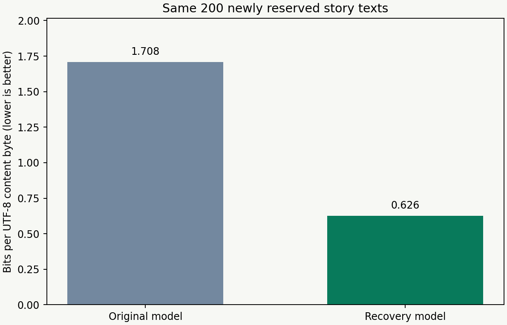

# StorySeed 🌱

**A small language model built from scratch to continue short English stories.**

Write a story opening, choose generation settings, and explore what the model writes next. StorySeed covers text preparation, tokenization, Transformer training, evaluation, and a local desktop app.

The weights were trained from random initialization using PyTorch and a subset of **TinyStories**. Generation runs locally without a hosted AI API.

## What we built

- An explicitly implemented GPT-style causal Transformer.
- A training-only byte-level BPE tokenizer and separate story-level data splits.
- GPU training with mixed precision, gradient accumulation, and resumable checkpoints.
- A Tkinter desktop app and command-line interface for CPU generation.
- Recorded learning curves, model comparisons, and unedited sample outputs.

## Model at a glance

| Detail | Value |
|---|---|
| Parameters | 8.47 million |
| Architecture | 8 Transformer layers, 8 attention heads per layer |
| Vocabulary / context | 4,096 tokens / 256 tokens |
| Training stories | 58,968 |
| Development / final-test stories | 200 / 200 separate stories |
| Training updates | 48,000 across two declared stages |
| Tools | Python, PyTorch, NumPy, Hugging Face Tokenizers, Tkinter |

## How it works

```text
Story opening → token IDs → embeddings → Transformer blocks
             → next-token scores → sample a token → repeat
```

The model generates one token at a time, using the latest 256 tokens as context. A token can be a word, part of a word, or punctuation.

## Run locally

**Trained weights are excluded from Git. Cloning alone does not provide a runnable trained model.** Use the separately provided `StorySeed-quality-recovery.zip` bundle, which contains the weights, matching tokenizer, and application source.

Install Python 3.12, extract the bundle, and run these commands from its folder on Windows:

```powershell
py -3.12 -m venv .venv
.venv/Scripts/python -m pip install -r requirements-inference.txt
.venv/Scripts/python launch.py --gui
```

Or generate from the command line:

```powershell
.venv/Scripts/python launch.py --prompt "A little rabbit found a red box."
```

The desktop app requires Tkinter. After dependency installation, inference works offline. See [setup instructions](docs/LOCAL_APP.md) for repository usage and troubleshooting.

### App controls

| Control | Default | Purpose |
|---|---:|---|
| Seed | 17 | Makes random sampling repeatable on the same setup |
| Temperature | 0.8 | Adjusts how strongly higher-scoring tokens are favored |
| Top-k | 40 | Chooses from the highest-scoring 40 candidates at each step |
| New IDs | 192 | Maximum additional tokens to generate; app limit is 512 |

The app can copy the full story or save the output and settings as JSON. Generation stops at an end token or the requested limit.

## Results

Both models were evaluated on the same **200 final-test stories**:

| Model | Encoded-path bits per UTF-8 content byte ↓ |
|---|---:|
| Original StorySeed | 1.708 |
| Recovery model | 0.626 |

This is a **63.3% reduction in predictive loss per byte**, not an accuracy or story-quality percentage. Data, tokenization, context, and training budget changed together, so the comparison does not isolate any single improvement.



**Readability improved, but reliable story continuation remains an unfinished goal.** Outputs can repeat, confuse characters, change objects, or stop mid-sentence. This is an educational prototype; independent human quality ratings are pending.

## Explore the project

| Location | Contents |
|---|---|
| [`src/storyseed/`](src/storyseed/) | Data, models, training, generation, and app |
| [`scripts/`](scripts/) | Preparation, training, evaluation, and packaging commands |
| [`reports/quality_recovery/`](reports/quality_recovery/) | Actual results and retained sample outputs |
| [`docs/media/quality-recovery/`](docs/media/quality-recovery/) | Charts, exact statistics, and captions |
| [Build roadmap](planning/END_TO_END_PLAN.md) | The phased learning and implementation journey |

For more detail, read the [model card](docs/RECOVERY_MODEL_CARD.md), [project report](docs/QUALITY_RECOVERY_REPORT.md), and [sample review](reports/quality_recovery/ASSISTANT_REVIEW.md). Detailed teaching chapters are maintained separately; the [lesson map](planning/LESSON_MAP.md) connects them to the code. The [earlier README](docs/history/README-before-2026-11-23.md) preserves historical progress.

## Acknowledgments

Training text comes from **TinyStories**, introduced by Ronen Eldan and Yuanzhi Li. Dataset attribution, pinned source revision, and terms are recorded in the [model card](docs/RECOVERY_MODEL_CARD.md).
