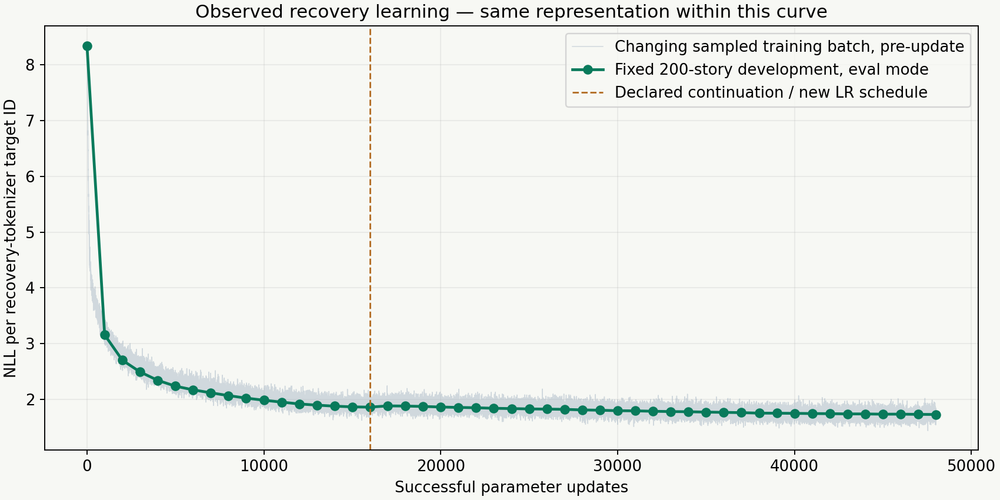
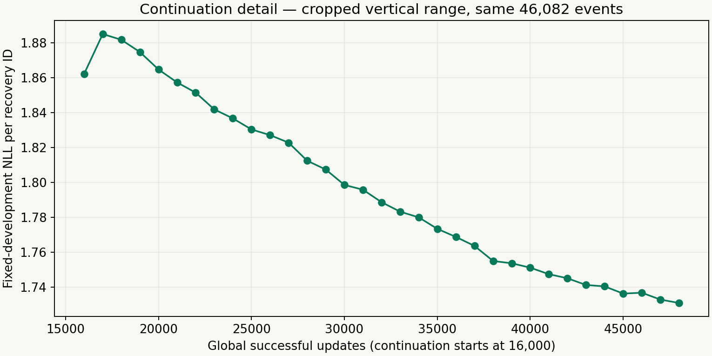
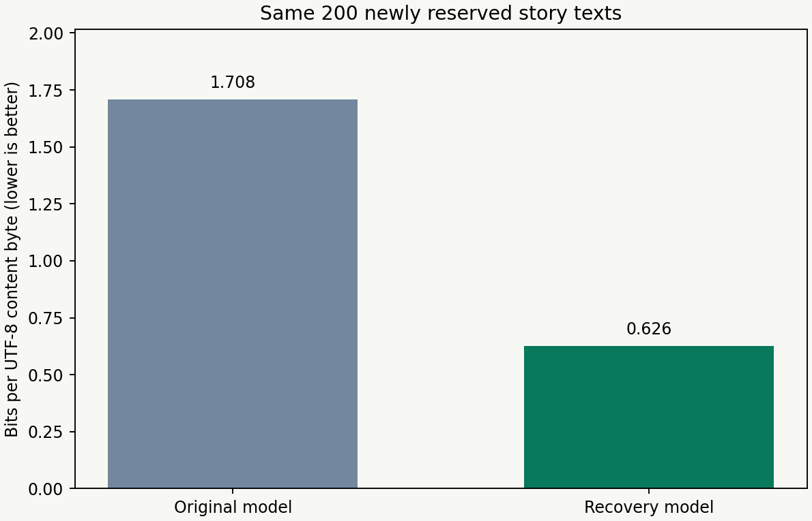
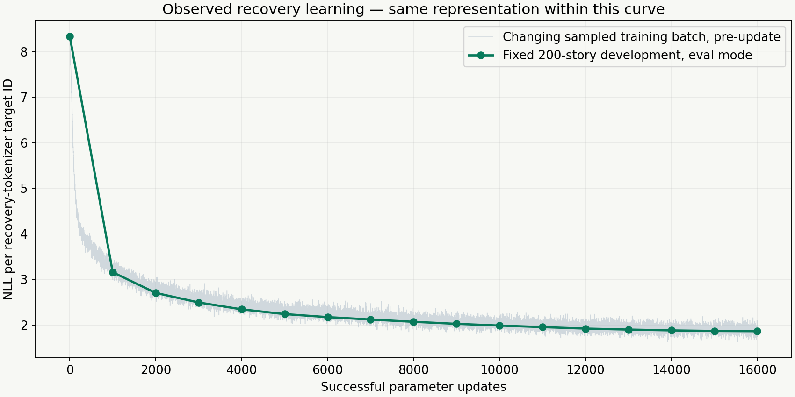

# StorySeed measured training charts

Saved PNG and SVG copies for future GitHub, university and social use. Read [captions and measurement limits](CAPTIONS_AND_REUSE.md) and [exact stats/file hashes](STATS_AND_CHARTS.json) before reusing a figure. The model trained on 58,968 stories; the 200-story labels identify development/final measurement populations.

## Full recovery learning

## Continuation detail

## Fixed same-text comparison

## Historical first recovery stage

Earlier phase charts are saved separately under ../historical-phases. Original note images remain unchanged. No trained tensors or raw story corpus are included in this image pack.
